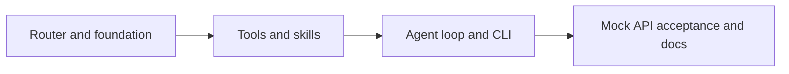
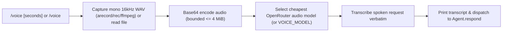
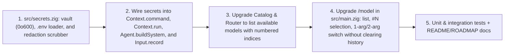

# Omnicode roadmap

Build a small Zig 0.17 coding agent inspired by [nanocode](https://github.com/1rgs/nanocode).
Minimize maintained code, not readability or correctness. No SDKs, framework,
database, background service, or speculative abstractions.

## Architecture

`CLI -> conversation loop -> provider router -> Messages API`

`model tool calls -> local tools / skill loader -> tool results -> loop`

Use the same Messages protocol for Anthropic and OpenRouter. Select fast/strong
models automatically using a documented task heuristic, with explicit provider
selection and a manual model override. Pin routing per turn.
Do not silently retry mutations or switch providers. Skills are local instructions,
not plugins: advertise names/descriptions and load a body only when requested.

## Increments

1. **Router and foundation:** replace template build noise, implement route
   selection, test defaults and invalid configuration. Commit and push.
2. **Tools and skills:** read/write/edit, glob/grep via ripgrep, bounded shell
   execution, local skill discovery and validated loading. Test real filesystem
   effects, failures, output limits, and timeouts. Commit and push.
3. **Agent and CLI:** native HTTP/JSON, sequential tool round trips, retained
   conversation, one-shot prompts and REPL, clear/model/skill commands, bounded
   turns and history. Build and test. Commit and push.
4. **Acceptance:** run the binary against a local mock Messages endpoint for both
   routes, tool errors, malformed/truncated responses, history, skills, and CLI
   failures. Document usage and exact limits; review diff and LOC. Commit and push.

Every increment must build and pass focused checks before committing. Never
include keys or private configuration. Live paid API calls are not needed for
automated verification.

## Scope boundaries

Trusted local use: tools operate with the user's permissions, without a sandbox.
Initial scope is POSIX, Zig 0.17.0, and ripgrep for glob/regex search. No streaming,
LLM-based routing classifier, MCP, persisted sessions, or full YAML parser.

## Primary references

- Zig 0.17.0 installed standard-library source: `std.process`, `std.Io`,
  `std.http.Client`, and `std.json` (implementation must follow this exact version).
- [Anthropic tool calls](https://platform.claude.com/docs/en/agents-and-tools/tool-use/handle-tool-calls)
- [Anthropic stop reasons](https://platform.claude.com/docs/en/build-with-claude/handling-stop-reasons)
- [OpenRouter Messages endpoint](https://openrouter.ai/docs/api/api-reference/anthropic-messages/create-messages)

## Progress

- [x] Inspect template, reference implementation, installed Zig APIs and API docs.
- [x] Router and foundation (route tests and build pass).
- [x] Tools and skills (real file, skill, deadline and output-limit tests).
- [x] Agent and CLI (build, unit tests, offline help and skill listing pass).
- [x] Acceptance and documentation (7 unit tests and 11 integration tests pass).

## Completed roadmap



The initial implementation used roughly 600 physical lines of Zig including unit
tests and build configuration. Integration tests are separate Python standard-library
code. Minimize future growth by adding capabilities to the existing tool registry
and routing policy before introducing new layers.

Acceptance found a Zig 0.17.0 HTTP client discrepancy: `privileged_headers` are
stored but not emitted by `Request.sendHead`. Authentication uses `extra_headers`
with redirects disabled; integration tests verify both providers' actual headers.
Automated verification uses fake keys and a loopback server. Live OpenRouter
checks also passed with the default Haiku and Sonnet routes: reading a fixture,
loading a skill, editing the fixture, and executing its verification command.
Live testing exposed an extra numbered line after a trailing newline; the read
tool now preserves actual blank lines without inventing an EOF line, with
regression coverage for empty files and trailing newlines.

## Terminal UI increment

Borrow interaction patterns from Codex; implement them directly in Zig, without
porting its Rust renderer or introducing a terminal framework.

| Codex pattern | Omnicode adaptation |
|---|---|
| [Command cells and head/tail previews](https://github.com/openai/codex/blob/main/codex-rs/tui/src/exec_cell/render.rs) | Tool arguments, completion state/timing, first three/last two lines, explicit omission counts, full-output toggle |
| [Live status row](https://github.com/openai/codex/blob/main/codex-rs/tui/src/status_indicator_widget.rs) | A single waiting line with elapsed seconds, cleared when the operation finishes |
| [Diff presentation](https://github.com/openai/codex/blob/main/codex-rs/tui/src/diff_render.rs) | Red/green old/new replacement snippets after successful edits |
| [Change review](https://support.claude.com/en/articles/14553413-claude-code-cheatsheet) | `/diff` prints bounded, redacted Git status and tracked changes in native scrollback |
| [Composer help and command discovery](https://github.com/openai/codex/blob/main/codex-rs/tui/src/bottom_pane/chat_composer.rs) | Startup hints, explicit `/help`, routing status, and verbose-output controls |

Keep the transcript in normal terminal scrollback. This first increment used
canonical input; the later fx increment adds a scoped raw-input module. No
alternate screen or keyboard shortcut claims that the implementation cannot fulfill.
Honor `NO_COLOR`, redirected output, and dumb terminals. Sanitize untrusted
terminal controls and preserve UTF-8 boundaries. Preserve tool data sent to the
model; display formatting belongs in a small standalone renderer.

Verification: unit tests plus integration tests with real pseudo-terminals,
both styled and `NO_COLOR`. Include delayed responses to exercise the waiting
indicator, malformed tool results, compact/full output, and edit/failure display.
Live OpenRouter verification also completed read/edit/command calls with the new
transcript, and the edited fixture contents were checked directly.

## fx study and small UI commits

Studied installed fx 0.0.14 and Vercel's source pinned at
[`2327e3c`](https://github.com/vercel-labs/fx/tree/2327e3cb8e6ce449836f22fdc6c32437fd8c5cbc).
The CLI's `ask --no-save` rendered a user card, a compact tool summary, and a
visible denial when safety review was unavailable. Successful command rendering
was not verified in that run. No fx configuration or access policy was changed.

Source observations:

- [Theme](https://github.com/vercel-labs/fx/blob/2327e3cb8e6ce449836f22fdc6c32437fd8c5cbc/src/core/shared/theme.zig): semantic styles and predominantly neutral defaults.
- [Tool projection](https://github.com/vercel-labs/fx/blob/2327e3cb8e6ce449836f22fdc6c32437fd8c5cbc/src/ui/transcript/tool_group_projection.zig): compact/expanded views derived from retained tool records, with failures tracked separately.
- [Activity status](https://github.com/vercel-labs/fx/blob/2327e3cb8e6ce449836f22fdc6c32437fd8c5cbc/src/core/output/activity_status.zig): phase, elapsed time, and token counters share a status presentation.
- [Terminal runtime](https://github.com/vercel-labs/fx/blob/2327e3cb8e6ce449836f22fdc6c32437fd8c5cbc/src/ui/shell_runtime.zig): raw input and terminal restoration are explicit responsibilities.

Our adaptation should borrow the hierarchy, without copying fx's larger runtime.
Implement each numbered item as an independently verified commit, splitting it
further if it changes more than one behavior:

1. [x] Quiet routine chrome: neutral headings and completion, dim routing metadata;
   retain distinct failure and diff cues. Existing PTY tests verify styling and
   `NO_COLOR` behavior.
2. [x] Compact routine tool presentation; keep arguments, outcome, and omitted-output
   counts visible. Verify failures and verbose output before changing defaults.
3. [x] Retain bounded display details and add a command to recover the last omitted
   output. Verify eviction and terminal-control sanitization.
4. [x] Render basic Markdown headings and code fences. Verify literal code content
   and redirected output independently.
5. [x] Add an input module with terminal restoration and bracketed paste; test
   interruption and EOF before adding history or multiline editing in later commits.

These are proposed Omnicode choices, not claims that fx uses the same design.
Keep native scrollback and avoid new dependencies; measure LOC growth per change.


Completed in separate commits: neutral styling, redundant tool-row removal,
`/details` (one replaceable 64 KiB result), headings/backtick fences, scoped raw
input with bracketed paste, and bounded up/down input history with secret
redaction. Multiline editing remains a follow-on feature. The feed now separates
assistant and Bash output, retains four recent Bash results for `/out`, and
offers `/diff` for a bounded Git status and tracked-change view; untracked file
contents are not included. Input and transcript state preserve the project's
normal scrollback model.

Interactive sessions started inside a tmux pane at 100 columns or wider open a
temporary right-hand Bash output pane using tmux's `split-window -I`. Bash
commands appear there before execution, and complete stdout/stderr lines stream
as they arrive. Bare carriage returns replace the pending line so progress
meters show their latest state; captured results are normalized the same way
for `/out` and model tool results. Assistant text and a compact Bash-result
preview remain in the Omnicode feed, with `/out` available for the full result.
Live lines are secret-scrubbed and
terminal controls are rendered visibly; incomplete lines are withheld after
interruption. Completed streams are not printed a second time; failed or
interrupted streams retain the final-result fallback. The pane is removed when
Omnicode exits. In the interactive REPL, narrowing below 100 columns closes the
pane and widening reopens it. Narrow startup, non-tmux terminals, and tmux
startup failures keep the inline Bash renderer. This uses tmux's documented
stdin forwarding for `split-window -I`, without shell interpolation or a
persistent output file.
See the [tmux manual](https://github.com/tmux/tmux/blob/master/tmux.1).
Verification includes real PTY cancellation/EOF, paste submission, and termios
restoration both during API requests and after exit. Terminal sequences follow
[xterm's bracketed-paste protocol](https://invisible-island.net/xterm/ctlseqs/ctlseqs.html).


## Economical routing and usage (completed)

- [x] OpenRouter defaults: GPT-4.1 Nano for lookups, GPT-4.1 Mini for development;
  direct Anthropic uses Haiku 4.5. Existing model overrides remain supported.
- [x] Report per-turn input/output/cache tokens and provider cost or labeled
  estimates. Keep missing metadata and unknown prices visible.
- [x] `/usage` session totals survive conversation clears and model changes.
- [x] Fake-server tests cover multiple responses, failures, estimates, and resets;
  live defaults complete read/edit/command calls and return billed usage.

Live Nano read round trip: 617 input tokens, 37 output tokens, two responses,
$0.00007650 reported by OpenRouter. Session totals remained intact after `/c`.
See README for pricing sources and estimation limits.

## Live catalog routing (completed)

Supersedes the static GPT-4.1 Nano/Mini defaults and fallback price table above.

- [x] Shared bounded JSON transport (`http.zig`) for inference and model metadata.
- [x] OpenRouter models are selected per turn from the live public catalog: tool
  support, text output, ≥32k context, ≥8k completion, concrete IDs only. The
  ranked pool is capped at 16 (development) / 32 (lookup) candidates under `--cost-max`.
- [x] `--free` restricts selection to all-zero prices across the full catalog and
  sends a zero `max_price` provider constraint; paid overrides are rejected.
- [x] Usage estimates use the fetched catalog rates for the selected model.
- [x] `--` passes the remaining arguments literally; `--help`/`--skills` stay offline.
- [x] Reasoning blocks (`thinking`, `redacted_thinking`) are preserved in history
  so GLM/DeepSeek tool continuations stay valid.

## Plan mode (completed)

`--plan` starts a one-shot task or REPL in read-only planning mode. `/plan on`
and `/plan off` switch modes during a REPL. The mode updates both the system
instructions and the advertised tool schema; only `read`, `glob`, `grep`, and
`skill` remain available while planning. A session started with `--read-only`
keeps that restriction after `/plan off`.

This adapts Claude Code's documented read-only Plan mode and Codex's separate
permission profile boundary, using the existing tool allowlist. fx also exposes
an explicit permission mode. Omnicode keeps this increment small and does not
add a per-action approval system.

- [Claude Code Plan mode](https://support.claude.com/en/articles/14553413-claude-code-cheatsheet)
- [Codex permission instructions](https://github.com/openai/codex/blob/main/codex-rs/prompts/src/permissions_instructions.rs)
- [fx permission modes](https://fx.sh/docs/configure-fx/permissions)

## Subagents and compaction (completed)

### Problem

A long task currently fails all at once. After 32 model calls in one turn
(`TurnLimit`), or 128 messages / 2 MiB of serialized history (`HistoryLimit`),
`main.zig` prints "Conversation limit reached", clears history, and
reinitializes the agent. File edits and commands already run stay on disk, but
the model's understanding of them is lost, and the user has to reconstruct the
context by hand. The two pressures are different:

- **Breadth:** exploration (reading many files, grepping) fills the parent
  context with raw tool output that is needed only briefly.
- **Length:** a coherent task can simply need more than 32 calls or 128 messages.

Subagents address breadth, compaction addresses length, and both reuse existing
pieces (`Agent`, `Route`, `Catalog`, `Usage`, `Ui`). Neither needs new
dependencies or a new layer.

### 1. Compaction (do first)

| Item | Design |
|---|---|
| Trigger | Before each request, when history exceeds a byte budget (e.g. 75% of the 2 MiB request limit or ~96 messages), and also instead of failing when a limit is about to be hit |
| Summary call | One extra Messages request on the **fast** route, without tools: "Summarize goal, decisions, files changed (paths + what), commands run and their results, open TODOs." Bounded `max_tokens` (e.g. 2048) |
| Replacement | History becomes `[user: original task + "<summary>…</summary>"]` + the last N complete exchanges. Never split a `tool_use` from its `tool_result`, and keep the reasoning blocks attached to their turn |
| Turn limit | On reaching 32 calls, compact and give a fresh 32-call budget, up to a hard cap (e.g. 3 compactions per turn), then fail as today |
| Error path | When a turn fails, keep a compacted summary instead of clearing history entirely, so "Inspect completed tool effects" becomes "here is what was done" |
| Commands | `/compact [focus]` manually; `/context` shows message count, bytes, and remaining budget |
| Usage | Summary requests count in turn and session `Usage` and are labeled `compaction` |
| Memory | Rebuild the arena after compaction (copy the summary and the kept tail into a new arena), as `/c` does, so long sessions do not grow without bound |

Tests: a mock server that returns many `tool_use` replies verifies that compaction
fires, that tool pairs stay intact, that the summary request carries no tools, that
usage is counted, and that the hard cap still produces `TurnLimit`.

### 2. Subagents (`task` tool)

| Item | Design |
|---|---|
| Tool | `{"name":"task","input":{"prompt":string,"tier":"fast"\|"strong"?}}`: "Delegate a self-contained investigation; returns only a final report" |
| Execution | Create a child `Agent` with a scratch arena, its own history and system prompt ("You are a subagent. Do the task and finish with a concise report"), the same `Context`, and a route from `forTask` (or the explicit tier) through the catalog |
| Isolation | Only the child's final text returns to the parent as the `tool_result`, capped at 64 KiB like other tools. Intermediate tool output never enters the parent context |
| Limits | Depth 1 (children don't get the `task` tool), a smaller budget (e.g. 16 calls), and the child's own compaction. A child that hits its limit returns a partial report rather than failing the parent turn |
| Read-only option | `"mode":"explore"` gives the child only read/glob/grep/skill, which is safe for cheap fast-tier models; write tools only with `"mode":"edit"` |
| UI | Child tool calls are indented under `• task …` with compact previews; `/details` holds the child's full report |
| Usage | Child usage rolls into the parent turn and session totals, shown as a separate line |
| Cost routing | Exploration subagents use the fast/`--free` tier while the parent stays on strong. This is the main cost saving with catalog routing |

Sequential execution first (matching the current single-threaded loop). Running
subagents in parallel for several `task` calls in one response is a later
increment, and needs care with shared-file writes and UI output ordering.

Tests: the mock server scripts a parent `task` call, child read/grep calls and a
child report. Assert that the parent history contains only the report, that depth
is enforced, that explore mode refuses writes, that a child limit gives a partial
report, and that usage adds up.

### 3. Smaller follow-ups

- **Session persistence:** `/save` and `/resume` the (compacted) history as JSON
  under `.omnicode/sessions/`, so a cleared or crashed REPL can continue.
- **Prompt caching:** add `cache_control` to the system prompt, the tool schemas
  and the summary block. Compaction keeps a stable prefix, which raises cache hits.
- **Token-aware limits:** use the reported `input_tokens` against the catalog
  `context_length` instead of a fixed byte budget.
- **Retry for reads only:** retry idempotent HTTP failures (429/5xx) once with
  backoff. Mutating tool effects are never replayed.
- [x] **Plan/todo tool:** the in-memory checklist survives compaction and anchors long tasks.
- [x] **Input history:** up/down arrows navigate bounded, secret-scrubbed prompt history.

### Order


Each step is its own commit, with unit tests, mock-server integration tests and
a LOC check, following the increments above.

## Status bar: model · directory · time (completed)

### Goal

Keep the current provider/model, working directory, and local time visible
without scrolling back to the banner or the last `• route` line. In automatic
mode the model changes from turn to turn, so the bar is the only place the user
can see the routing state at a glance.

### Constraints from earlier decisions

- The transcript stays in **native scrollback**: no alternate screen, no terminal
  framework, no new dependencies (see "Terminal UI increment").
- The waiting indicator already owns the current line during work (`\r\x1b[2K`
  redraws in `Ui.work`), and the raw composer owns it while the user types.
- Plain output (pipes, `TERM=dumb`, one-shot prompts) must stay free of escape
  sequences and redraw noise.

### Options considered

| Option | Mechanism | Verdict |
|---|---|---|
| A. Inline status line | Print one dim line directly above each prompt | **Phase 1.** Uses no cursor tricks, works with canonical and raw input, paste, wrapping and resizes. Because the prompt is almost always the last screen row, the line sits at the bottom whenever the user is idle. The copies left in scrollback also act as per-turn timestamps |
| B. Footer below the composer | Draw the line under the prompt, move the cursor up, erase on submit | Rejected for now. Pasted newlines and wrapped input overwrite it, so the composer would need full redraw logic, which the roadmap deliberately avoided |
| C. Pinned bottom row | Reserve the last row with a scroll region (`DECSTBM` `\x1b[1;{rows-1}r`), draw the bar at `rows`, restore with `\x1b[r` | **Phase 2, opt-in.** A true always-visible bar, including during long tool runs. It risks scrollback (some terminals and multiplexers don't save lines that scroll out of a partial region), needs the terminal size and resize (`SIGWINCH`) handling, and must restore the terminal on every exit path |
| D. Alternate-screen TUI | Full-screen renderer | Rejected: it breaks native scrollback and copy behaviour, which the project explicitly keeps |
| E. Terminal title (`OSC 0/2`) | Put the status in the window/tab title | An optional extra (`/status title`). It costs nothing to the transcript, but isn't visible in every setup and some multiplexers drop it |

### Content and layout

```text
 openrouter · auto (cost-max) → z-ai/glm-4.6 · ~/Projects/omnicode · 10:25
```

| Field | Source | Notes |
|---|---|---|
| Provider | `Route.provider` | Always shown |
| Model | Pinned: `Route.model`. Automatic: `auto (cost-max\|free)` plus `→ last selected model` after the first turn | The catalog picks the model inside `respond`, so before a turn only the policy is known; never show a guessed model as current |
| Directory | `std.process.currentPathAlloc` with `$HOME` shortened to `~` | Middle-elided with `…` when space is short |
| Time | Local `HH:MM` | See "Local time" below |
| Later (optional) | Session cost from `/usage`, context budget from `/context` (after compaction), Git branch read from `.git/HEAD` (no subprocess) | Add only once the base bar is stable; each must be cheap to compute without I/O at render time |

Truncation priority when narrow: shorten the directory first, then the model
(cut at the end with `…`), then drop the time. Provider and the start of the
model always remain. All fields go through the existing control-character
sanitizer, and cut points respect UTF-8 boundaries (the same rules as tool previews).

### Local time

Zig's `std.time` has no timezone conversion, but `std.tz.Tz.parse` reads TZif
data. At startup, load `$TZ` when it names a zoneinfo file, else `/etc/localtime`.
Find the offset from the transition table and format `HH:MM`. If loading fails,
show `HH:MM UTC` explicitly rather than presenting UTC as local time. Do this once
and cache the transitions; no subprocess (`date`) and no per-render file I/O.

When the time refreshes:

- Inline (Phase 1): when each prompt is drawn. Text in scrollback is never
  rewritten, which is correct because each line records when that prompt began.
- Pinned (Phase 2): at each prompt, on every waiting-indicator tick (already
  periodic in `Ui.work`), and once a minute while idle. That last case needs the
  composer to wait on input with a timeout (`poll`) instead of a blocking read.

### Terminal width

`COLUMNS` is usually not exported by shells, so `Ui.width` often falls back to 80.
Query the real size with the `TIOCGWINSZ` ioctl when stdout is a TTY, fall back
to `COLUMNS`, then 80. Tool previews benefit from the same improvement. Phase 2
also needs the row count and a `SIGWINCH` handler that only sets an atomic flag.
The next redraw then resets the scroll region and repaints, with no terminal
writes inside the signal handler.

### Phase 2 safety (pinned bar)

- Enter the scroll region only in the styled interactive REPL (stdin and stdout
  are TTYs, not `TERM=dumb` or `NO_COLOR`), matching when the raw composer is used.
- Restore (`\x1b[r`, clear the last row, move the cursor to the bottom) on `/q`,
  Ctrl-D, error returns, and before handing the terminal to anything interactive.
  Register the restore with `defer` next to the existing termios restore. Document
  `reset` as the manual way to recover after a hard kill.
- Before printing transcript text, make sure the cursor is inside the scroll
  region so output never lands on the bar row.
- Draw the bar with save/restore cursor (`\x1b7`…`\x1b8`) and a clear line,
  dimmed, and never wider than the width minus one column (to avoid auto-wrap
  scrolling the region).
- Fall back to Phase 1 automatically when the size can't be read or rows < 10.

### Controls

`/status inline|pinned|title|off` in the REPL and `OMNICODE_STATUS` with the same
values. The default is `inline` for interactive TTYs and `off` for plain output and
one-shot prompts. `pinned` stays opt-in until it passes the terminal matrix below.

### Implementation sketch

- `ui.zig`: a pure `statusLine(buf, width, fields) []const u8` (formatting and
  truncation only, unit-testable), plus `Ui.status()` that renders according to mode.
- `main.zig`: call `ui.status()` before `ui.prompt()`, and store the last selected
  route so automatic mode can show `→ model`. `Agent.respond` already has the
  selected route and can return or store it.
- Small time helper (TZif load and offset lookup) next to `ui.zig`. Phase 1 is
  about 60 lines including tests; Phase 2 adds about 80 for the size, resize,
  scroll region and restore logic.

### Verification

- Unit: field truncation order, `~` substitution, UTF-8-safe cuts, sanitizing a
  model ID that contains control characters, TZif offset lookup with a fixture
  zone, and the UTC fallback label.
- PTY integration (existing Python harness): the inline line appears before each
  prompt in a styled PTY; it is absent with piped output, `TERM=dumb`, and one-shot
  prompts; the `→ model` text updates after a mocked turn.
- Phase 2: assert that `DECSTBM` is set at startup and reset on `/q`, on EOF, and
  after an API error. Resize the PTY (`TIOCSWINSZ`, then `SIGWINCH`) and check the
  region is redrawn for the new row count.
- Manual matrix before making `pinned` the default: xterm, GNOME Terminal (VTE),
  kitty, Alacritty, WezTerm, tmux, and screen. Check scrollback is kept, copy/paste
  works, and resizing behaves during a long `bash` tool run.

### Placement in the order

Phase 1 doesn't depend on compaction or subagents and is small, so it can land
first. Once compaction exists, the bar is the natural place for the `/context`
budget. Once subagents exist, it can show `task 1/1 · fast`. Phase 2 follows
after the inline bar has been used for a while.


## `/exit`, `/init`, bottom-pinned status bar default, and adversarial multi-agent review (completed)

### 1. `/exit` and bottom-pinned status bar by default

- **`/exit`:** Support `/exit` alongside `/q` and `exit` to quit the REPL cleanly,
  restoring any active scroll region and title stack.
- **Bottom-pinned status bar by default:** Interactive terminals with at least 10 rows
  now default to `Status.Mode.pinned`, reserving the bottom row via `DECSTBM`
  (`\x1b[1;{rows-1}r`) and rendering the status line at `\x1b[{rows};1H` using cursor
  save/restore (`\x1b7`…`\x1b8`). When `rows < 10` or size cannot be determined,
  `statusBar` falls back to inline rendering. On exit (`/q`, `/exit`, `exit`, Ctrl-D,
  or error), `resetScrollRegion` always resets `\x1b[r` and clears the bottom row.

### 2. `/init` project onboarding and `OMNICODE.md` instructions

- **`OMNICODE.md` loading:** When `Agent.init` builds the system prompt, if an
  `OMNICODE.md` file exists in the working directory (up to 64 KiB), its contents are
  appended to the system prompt under `Project instructions (OMNICODE.md):` so every
  turn and subagent benefits from project conventions automatically.
- **`/init` command (and `--init` CLI flag):** Inspects the workspace (`build.zig`,
  `package.json`, `Cargo.toml`, `pyproject.toml`, `Makefile`, `go.mod`, directory
  layout) and generates:
  1. `OMNICODE.md` with build, test, format, and style rules tailored to the detected
     stack (unless it already exists; `/init force` overwrites).
  2. `.omnicode/skills/verify/SKILL.md` with concrete verification steps (unless it
     already exists).
  3. Reloads the agent's system prompt so the new instructions and skills take effect
     immediately in the current session.

### 3. Adversarial multi-agent review (`review` tool and `/review` command)

#### Why single-agent self-review fails

When the same model context both writes code and reviews it, confirmation bias and
shared blind spots cause it to overlook subtle bugs, edge-case regressions, unhandled
errors, security boundary violations, and "AI slop" (dead code, redundant abstractions,
placeholder comments, unnecessary dependencies, or unverified claims).

#### Adversarial multi-agent architecture


| Component | Responsibility |
|---|---|
| **Diff & Context Collector** | Runs `git status --short` and `git diff HEAD` (bounded to 64 KiB) in the workspace so critics inspect actual filesystem mutations rather than the author's claims |
| **Critic 1: Correctness & Security** | Fresh read-only child `Agent` (`explore_schema` only, zero shared history with the author). Adversarial system prompt: assume the diff has bugs; hunt for logic errors, off-by-one, resource/arena leaks, error paths, race/timeout hazards, and security/credential issues. Must cite `file:line` |
| **Critic 2: Anti-Slop & Minimalism** | Fresh read-only child `Agent` (`explore_schema` only). Adversarial system prompt: hunt for AI slop—unrequested features, dead code, verbose/speculative abstractions, comments that restate code, formatting drift, or missing tests for new behavior. Must cite `file:line` |
| **Verdict Protocol** | Each critic must end its report with `VERDICT: PASS` or `VERDICT: FAIL` and a numbered list of concrete, falsifiable findings (`[severity] file:line — issue & fix`). Vague praise is forbidden |
| **`review` tool** | Callable by the parent agent (`{"name":"review","input":{"focus":string?}}`). Runs both adversarial critics on the current working tree diff and returns the combined report and overall `VERDICT: PASS\|FAIL` |
| **`/review [focus]` REPL command** | Runs the two-critic adversarial review directly from the REPL; if either critic reports `VERDICT: FAIL`, prints the findings and optionally feeds them into the agent to fix (`--review` or `/review fix`) |

#### Why this prevents mistakes and slop

1. **Context isolation:** Critics never see the author's chain-of-thought or excuses—only
   the ground-truth `git diff` and the repository files they read via `read`/`grep`/`glob`.
2. **Orthogonal incentives:** Splitting *Correctness/Security* from *Anti-Slop/Minimalism*
   prevents a single reviewer from trading simplicity for defensive bloat or vice versa.
3. **Read-only enforcement:** Critics use `read_only = true` (`explore_schema`), so they
   cannot silently mutate files while reviewing.
4. **Cost-aware routing:** Each critic is a bounded subagent whose token/cost usage rolls
   into the turn and session `Usage` totals.

### Implementation order

1. Bottom-pinned status bar by default + `/exit` command.
2. `/init` command, `--init` flag, and `OMNICODE.md` project instruction loading.
3. Adversarial multi-agent `review` tool and `/review [focus]` command.
4. Unit and integration tests covering `/exit`, default pinned status bar, `/init`,
   `OMNICODE.md`, and multi-agent adversarial review (`PASS` and `FAIL` verdicts).

## `/setup` multi-provider credential store, `/voice` OpenRouter audio input, and hardening (completed)

### 1. `/setup` and `--setup`: Multi-provider API keys and persistent configuration (`src/config.zig`, `src/router.zig`)

#### Why `/setup` is needed

Relying exclusively on shell environment variables (`ANTHROPIC_API_KEY`, `OPENROUTER_API_KEY`)
creates friction when switching providers or configuring secondary keys (such as an
OpenRouter key for `/voice` while using Anthropic or DeepSeek for code turns, or configuring
OpenAI, Gemini, Groq, xAI, and DeepSeek endpoints).

#### Design

| Aspect | Specification |
|---|---|
| **Storage location** | `$OMNICODE_CONFIG` if set, else `$XDG_CONFIG_HOME/omnicode/config.env`, else `$HOME/.config/omnicode/config.env` (fallback `.omnicode/config.env`). Written with `0o600` owner-only permissions; parsed values and serialized config buffers are securely cleared after use |
| **Precedence** | Explicit CLI flags / `/model` pin > process environment variables > persisted `config.env` > built-in defaults. `/setup` updates both the live in-memory `std.process.Environ.Map` and `config.env` so changes apply immediately without restarting; active route credentials and endpoints are rebound after settings or vault mutations, and allocated `Bearer` header copies are cleared after requests |
| **Supported providers** | `openrouter` (`OPENROUTER_API_KEY`), `anthropic` (`ANTHROPIC_API_KEY`), `deepseek` (`DEEPSEEK_API_KEY`), `xai` (`XAI_API_KEY`), `openai` (`OPENAI_API_KEY`), `gemini` (`GEMINI_API_KEY`), `groq` (`GROQ_API_KEY`) |
| **Secret masking** | `/setup` status output masks every stored key (e.g. `sk-or-…9f2a` or `***` for short keys) and never prints raw secrets to the transcript |
| **REPL & CLI commands** | `/setup` (status table), `/setup <provider> <api_key>` (save provider key and activate if appropriate), `/setup set <KEY> <VALUE>` (set `PROVIDER`, `MODEL`, `FAST_MODEL`, `VOICE_MODEL`, `VOICE_URL`, `API_URL`, `MODELS_URL`, `OMNICODE_STATUS`, or `*_API_KEY`), `/setup unset <KEY>` (remove key), plus offline `omnicode --setup [...]` |

### 2. `/voice`: Low-cost voice prompts via OpenRouter audio models (`src/voice.zig`, `src/catalog.zig`)

#### Reasoning on OpenRouter voice integration

OpenRouter exposes multimodal models that accept base64-encoded audio (`input_audio` content
blocks in `wav`, `mp3`, or `ogg` format) at very low cost—such as `google/gemini-2.0-flash-lite-001`,
`google/gemini-2.5-flash-lite`, and `openai/gpt-4o-mini-audio-preview`—and advertises `"audio"`
in `architecture.input_modalities` in the live `/api/v1/models` catalog.



| Aspect | Specification |
|---|---|
| **Audio capture** | `/voice` or `/voice record [seconds]` records mono 16 kHz WAV audio (`1..30`s, default `5`s) to `.omnicode/voice.wav` via `$OMNICODE_VOICE_CMD` if set, else auto-detecting `arecord`, `rec` (SoX), or `ffmpeg` |
| **Audio file input** | `/voice <path.wav\|mp3\|ogg>` reads an existing audio file (up to 4 MiB), enabling deterministic testing and pre-recorded voice notes |
| **Model selection** | `Catalog.selectVoice` picks the lowest-cost model in the OpenRouter catalog with `"audio"` in `architecture.input_modalities` and `"text"` in `architecture.output_modalities` (honoring `--free` when active), or uses `VOICE_MODEL` (default fallback `google/gemini-2.0-flash-lite-001`) |
| **Key resolution** | Uses `OPENROUTER_API_KEY` (configurable via `/setup openrouter <key>`) or the active route's key when `VOICE_URL` / `API_URL` is used |
| **Execution** | Sends the `input_audio` payload, parses either OpenRouter Chat Completions (`choices[0].message.content`) or Messages (`content[0].text`), records token/cost usage into `Ui.usage`, scrubs the transcript before display or prompt use, clears in-memory audio/request buffers, displays `🎙  <transcript>`, and runs `agent.respond(transcript, ui)` |

### 3. Correctness, latency, and maintainability hardening

- **`src/input.zig` long-CSI escape draining:** Drain oversized CSI sequences (`> 8` bytes) until their final byte (`0x40..0x7E`) so tail bytes never leak into the prompt buffer.
- **`src/status.zig` portable `TIOCGWINSZ`:** Use `std.posix.system.ioctl` across POSIX platforms rather than Linux-only `std.os.linux.ioctl`.
- **Per-turn catalog reuse (`src/agent.zig`):** Reuse the fetched `Catalog` across subagents (`task`), adversarial critics (`review`), and `compact` within the same turn or review invocation, eliminating redundant 8 MiB catalog downloads.
- **Comptime schema deduplication (`src/tools.zig`):** Derive `explore_schema`, `edit_schema`, and `schema` from a single tool definition table at `comptime`.
- **CI & repository hygiene (`.github/workflows/ci.yml`, `.gitignore`):** Add GitHub Actions workflow running `zig fmt --check`, `zig build test`, `zig build`, and `python3 tests/integration.py -v`, and ignore `__pycache__/` and `.omnicode/`.

### Implementation order

1. Implement `src/config.zig`, extended providers in `src/router.zig`, `/setup` REPL command, and `--setup` CLI flag.
2. Implement `src/voice.zig`, `Catalog.selectVoice` in `src/catalog.zig`, and `/voice` REPL command.
3. Apply correctness & latency hardening (`src/input.zig`, `src/status.zig`, `src/agent.zig` catalog caching, `src/tools.zig` comptime schema generation, `.gitignore`, `.github/workflows/ci.yml`).
4. Update `README.md` and `ROADMAP.md`, run full unit + integration suites, and commit.

## `/secrets` zero-leak vault & scrubber and `/model` available-model browser & switcher (completed)

### 1. `/secrets`: Zero-leak credential vault, subprocess injection, and output scrubbing (`src/secrets.zig`)

#### Threat model: how secrets leak in coding agents

Passwords, login tokens, database URLs, and API keys leak into chat feeds and remote LLM
requests through four paths:
1. **Tool output (`bash`, `read`, `grep`):** Running `env`, `cat .env`, `curl -v`, or reading
   config files sends raw secret values in `tool_result` blocks to the model provider and
   prints them to the terminal transcript and `/details`.
2. **User prompts:** Pasting a command or snippet containing a password or token stores it
   in `Agent.history` and sends it to the LLM.
3. **Session files (`/save`):** Persisting `.omnicode/sessions/<name>.json` writes `history`
   to disk in plaintext.
4. **Input composer history (`src/input.zig`):** Typing `/secrets set ...` or `/setup ...`
   stores the raw command in the Up/Down arrow history ring.

#### Architecture: "Use Without Seeing" + Mandatory Redaction Scrubber

```mermaid
flowchart LR
    V["/secrets set NAME VALUE<br/>(~/.config/omnicode/secrets.env 0o600)"] --> E["Child bash env ($NAME)"]
    V --> S["Redaction Scrubber (secrets + *_API_KEY)"]
    P["System Prompt: advertises secret NAMES only"] --> A["Agent runs: sh -c 'curl -H \"Bearer $TOKEN\"'"]
    A --> E
    E --> R["Raw tool output / file read / prompt"]
    R --> S
    S -->|"[REDACTED:NAME]"| C["LLM History + Terminal Feed + /details + /save"]
```

| Component | Design |
|---|---|
| **Storage (`secrets.env`)** | Stored at `$OMNICODE_SECRETS`, else `$XDG_CONFIG_HOME/omnicode/secrets.env`, else `$HOME/.config/omnicode/secrets.env` (fallback `.omnicode/secrets.env`) with `0o600` owner-only permissions. Imported and serialized vault buffers are securely cleared after use. |
| **REPL & CLI commands** | `/secrets` or `/secrets list` (list secret names + masked lengths, never values), `/secrets set <NAME> <VALUE>` (save or replace a secret and securely clear retired vault and environment values), `/secrets unset <NAME>` (remove secret and securely clear its active vault slot and environment copy), `/setup` replacement/removal also clears sensitive API-key and endpoint environment values, `/secrets load <file.env>` (import `.env` secrets without printing values); mutation working copies are also securely cleared after success or failure |
| **Subprocess injection** | `Context.command` (`src/tools.zig`) injects all stored secrets into the child process `environ_map` so `bash` commands can reference `$NAME` directly; captured output buffers are securely cleared after scrubbed results are prepared |
| **Name-only prompt advertisement** | `Agent.buildSystem` (`src/agent.zig`) appends `Available secret env vars (values hidden; reference as $NAME in bash): NAME1, NAME2` so the model uses secrets without ever seeing their values; project instructions and skill descriptions are scrubbed before inclusion, and skill bodies are scrubbed before tool results are retained |
| **Mandatory scrubber (`Secrets.scrub`)** | Scrubs every `Context.run` output, every user prompt entering `Agent.history`, and terminal previews. Longer values use `[REDACTED:<NAME>]`; short vault values and provider keys use same-length asterisks to avoid leaking them or expanding common one-character matches. Read-tool source and redacted intermediate buffers are cleared after formatting. |
| **History exclusion (`src/input.zig`)** | `Input.record` ignores lines starting with `/secrets` or `/setup`, and new history entries are scrubbed before retention; overwritten/redacted history slots and the processed input buffer are securely cleared |

---

### 2. `/model`: Available-model listing, numbered selection, and non-destructive switching (`src/catalog.zig`, `src/router.zig`, `src/main.zig`)

#### Goals

1. **Show available models on `/model` (or `/model list`):** Users need to see what models
   are currently available (both from the live OpenRouter catalog and configured providers)
   along with pricing, context window, and an index number so they can switch immediately.
2. **Switch models without wiping conversation history:** Changing models mid-session should
   preserve `Agent.history` and `Todo` state instead of resetting the session arena.
3. **Ergonomic switching syntax:** Support switching by index (`/model 2`), by model ID alone
   (`/model anthropic/claude-sonnet-4.5` or `/model deepseek-reasoner`), by tier
   (`/model fast`, `/model strong`, `/model auto`), or by explicit provider + model
   (`/model openrouter google/gemini-2.5-pro`).

#### Design

| Command | Behavior |
|---|---|
| `/model` or `/model list` | Displays current provider/model and routing policy, followed by a numbered list (`[1]`, `[2]`, …) of currently available models: live top-ranked OpenRouter catalog models (with `$ in / $ out per 1M` and context window) when OpenRouter is active/configured, plus built-in fast/strong models for configured providers (`anthropic`, `deepseek`, `xai`, `openai`, `gemini`, `groq`) |
| `/model <N>` | Switches directly to model `#N` from the available models list (e.g. `/model 1`) |
| `/model <MODEL_ID>` | Pins `<MODEL_ID>` on the current or inferred provider (inferring `openrouter` for `vendor/model` IDs, or matching known provider prefixes like `claude-`, `deepseek-`, `grok-`, `gpt-`, `gemini-`, `llama-`) |
| `/model <PROVIDER> <MODEL_ID>` | Switches to `<PROVIDER>` and pins `<MODEL_ID>` |
| `/model fast [MODEL_ID]` | Switches to the fast tier model, or updates `FAST_MODEL` if `MODEL_ID` is given |
| `/model strong [MODEL_ID]` | Switches to the strong tier model, or updates `MODEL` if `MODEL_ID` is given |
| `/model auto` | Restores automatic fast/strong task routing |

---

### Implementation order



1. **Increment 1 (`src/secrets.zig` + tool/prompt/input integration):**
   - Implement `Secrets` vault (`load`, `set`, `unset`, `loadEnvFile`, `scrub`, `namesList`, `statusReport`).
   - Inject secrets into `Context.command` child environment, scrub `Context.run` outputs and user prompts, advertise secret names in `Agent.buildSystem`, and exclude `/secrets` & `/setup` from `Input.record`.
2. **Increment 2 (`/model` available-model browser & switcher):**
   - Add `Catalog.formatAvailableModels` / provider model listing and numbered candidate cache.
   - Update `/model` in `src/main.zig` to display available models, support `/model <N>`, `/model <MODEL_ID>`, `/model <PROVIDER> <MODEL_ID>`, `/model fast|strong|auto`, and preserve conversation history across model switches.
3. **Increment 3 (Verification & documentation):**
   - Add unit tests in `src/secrets.zig` and `src/catalog.zig`, and end-to-end integration tests in `tests/integration.py` verifying zero-leak secret scrubbing across `bash`/`read`/`grep` and `/model` listing & switching.
