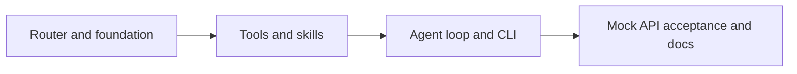

# Omnicode roadmap

Build a small Zig 0.17 coding agent inspired by [nanocode](https://github.com/1rgs/nanocode).
Minimize maintained code, not readability or correctness. No SDKs, framework,
database, background service, or speculative abstractions.

## Architecture

`CLI -> conversation loop -> provider router -> Messages API`

`model tool calls -> local tools / skill loader -> tool results -> loop`

Use the same Messages protocol for Anthropic and OpenRouter. Select fast/strong
models automatically using a documented task heuristic, with explicit provider
selection and a manual model override. Pin routing per turn.
Do not silently retry mutations or switch providers. Skills are local instructions,
not plugins: advertise names/descriptions and load a body only when requested.

## Increments

1. **Router and foundation:** replace template build noise, implement route
   selection, test defaults and invalid configuration. Commit and push.
2. **Tools and skills:** read/write/edit, glob/grep via ripgrep, bounded shell
   execution, local skill discovery and validated loading. Test real filesystem
   effects, failures, output limits, and timeouts. Commit and push.
3. **Agent and CLI:** native HTTP/JSON, sequential tool round trips, retained
   conversation, one-shot prompts and REPL, clear/model/skill commands, bounded
   turns and history. Build and test. Commit and push.
4. **Acceptance:** run the binary against a local mock Messages endpoint for both
   routes, tool errors, malformed/truncated responses, history, skills, and CLI
   failures. Document usage and exact limits; review diff and LOC. Commit and push.

Every increment must build and pass focused checks before committing. Never
include keys or private configuration. Live paid API calls are not needed for
automated verification.

## Scope boundaries

Trusted local use: tools operate with the user's permissions, without a sandbox.
Initial scope is POSIX, Zig 0.17.0, and ripgrep for glob/regex search. No streaming,
LLM-based routing classifier, MCP, persisted sessions, or full YAML parser.

## Primary references

- Zig 0.17.0 installed standard-library source: `std.process`, `std.Io`,
  `std.http.Client`, and `std.json` (implementation must follow this exact version).
- [Anthropic tool calls](https://platform.claude.com/docs/en/agents-and-tools/tool-use/handle-tool-calls)
- [Anthropic stop reasons](https://platform.claude.com/docs/en/build-with-claude/handling-stop-reasons)
- [OpenRouter Messages endpoint](https://openrouter.ai/docs/api/api-reference/anthropic-messages/create-messages)

## Progress

- [x] Inspect template, reference implementation, installed Zig APIs and API docs.
- [x] Router and foundation (route tests and build pass).
- [x] Tools and skills (real file, skill, deadline and output-limit tests).
- [x] Agent and CLI (build, unit tests, offline help and skill listing pass).
- [x] Acceptance and documentation (7 unit tests and 11 integration tests pass).

## Completed roadmap

The initial implementation used roughly 600 physical lines of Zig including unit
tests and build configuration. Integration tests are separate Python standard-library
code. Minimize future growth by adding capabilities to the existing tool registry
and routing policy before introducing new layers.

Acceptance found a Zig 0.17.0 HTTP client discrepancy: `privileged_headers` are
stored but not emitted by `Request.sendHead`. Authentication uses `extra_headers`
with redirects disabled; integration tests verify both providers' actual headers.
Automated verification uses fake keys and a loopback server. Live OpenRouter
checks also passed with the default Haiku and Sonnet routes: reading a fixture,
loading a skill, editing the fixture, and executing its verification command.
Live testing exposed an extra numbered line after a trailing newline; the read
tool now preserves actual blank lines without inventing an EOF line, with
regression coverage for empty files and trailing newlines.

## Terminal UI increment

Borrow interaction patterns from Codex; implement them directly in Zig, without
porting its Rust renderer or introducing a terminal framework.

| Codex pattern | Omnicode adaptation |
|---|---|
| [Command cells and head/tail previews](https://github.com/openai/codex/blob/main/codex-rs/tui/src/exec_cell/render.rs) | Tool arguments, completion state/timing, first three/last two lines, explicit omission counts, full-output toggle |
| [Live status row](https://github.com/openai/codex/blob/main/codex-rs/tui/src/status_indicator_widget.rs) | A single waiting line with elapsed seconds, cleared when the operation finishes |
| [Diff presentation](https://github.com/openai/codex/blob/main/codex-rs/tui/src/diff_render.rs) | Red/green old/new replacement snippets after successful edits |
| [Composer help and command discovery](https://github.com/openai/codex/blob/main/codex-rs/tui/src/bottom_pane/chat_composer.rs) | Startup hints, explicit `/help`, routing status, and verbose-output controls |

Keep the transcript in normal terminal scrollback. No raw-mode input, alternate
screen, or keyboard shortcut claims that the implementation cannot fulfill.
Honor `NO_COLOR`, redirected output, and dumb terminals. Sanitize untrusted
terminal controls and preserve UTF-8 boundaries. Preserve tool data sent to the
model; display formatting belongs in a small standalone renderer.

Verification: unit tests plus integration tests with real pseudo-terminals,
both styled and `NO_COLOR`. Include delayed responses to exercise the waiting
indicator, malformed tool results, compact/full output, and edit/failure display.
Live OpenRouter verification also completed read/edit/command calls with the new
transcript, and the edited fixture contents were checked directly.
